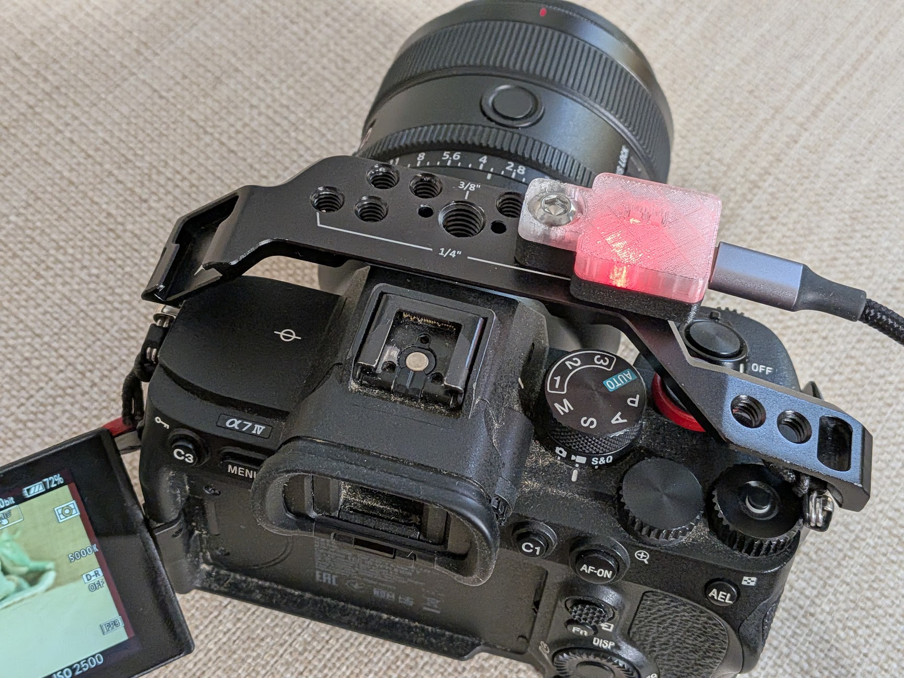
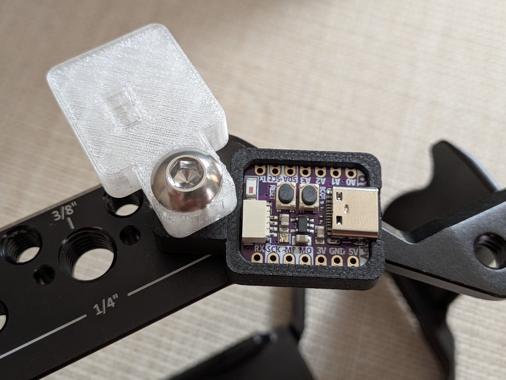

# Sony Tally Light

A small wireless tally light for Sony Alpha cameras. It sits on the camera cage and glows red while the camera is recording, solving an annoying and potentially devastating issue of not being aware of the record state of the camera. Using the camera on actual shoots, this was something that caused me constant worry.

This is based on previous reverse engineering work of the Sony Bluetooth remote protocol. These remotes receive a record state change from the camera, making it possible to create a tally light. It's a boring but necessary solution when the camera is rigged up.

## How it works

The firmware runs on an **Adafruit QT Py ESP32-S3** and drives the board's built-in NeoPixel. Nothing needs to be soldered. After pairing with the camera, the connection happens automatically. Record state is not known until the toggle. Then the light will glow red for recording and green for standby.

### LED states

| Color | Meaning |
| --- | --- |
| Dim blue | Scanning for a camera |
| Dim yellow | Connecting / bonding |
| Dim magenta | Connected, but the camera isn't offering the remote service (is **Bluetooth Rmt Ctrl** off?) |
| Dim white | Connected, recording state not reported yet |
| Dim green | Connected, not recording |
| **Bright red** | **Recording** |

### Buttons

- **Tap BOOT while connected** to start or stop recording. The board sends the camera a record toggle (the same command a Sony remote sends).
- **Erase stored bonds:** tap **RESET**, then press and hold **BOOT** right away (within about a second) and keep holding for a few seconds. The serial log will print `BOOT held -> erasing all bonds`.
  > Don't hold BOOT *while* you press RESET or plug in USB. If you do, the ESP32-S3 starts in its ROM bootloader instead of running the sketch.

## Bill of materials

| Qty | Part | Notes |
| --- | --- | --- |
| 1 | [Adafruit QT Py ESP32-S3](https://www.adafruit.com/product/5426) | No-PSRAM (5426) or 2 MB PSRAM ([5700](https://www.adafruit.com/product/5700)). Either version works. The LED is the onboard NeoPixel. |
| 1 | Base, `stls/tally_base-v2.stl` | Print in an opaque filament (black in the photos). Holds the QT Py. I used PCTG. |
| 1 | Cap, `stls/transparent-cap_v2.stl` | Print in clear or translucent filament. It diffuses the NeoPixel. I used flexible TPU. This additionally makes it easier to press the buttons. |
| 1 | 1/4"-20 button-head socket cap screw | Goes through the tabs on the cap and base into the cage. |
| 1 | USB-C cable + power source | For example, a small power bank. SmallRig V-mount batteries, for instance, provide USB-A or C out. |
| — | Camera cage, top handle, or plate with a 1/4"-20 threaded hole | The light is held together via the 1/4" screw, secured to the cage. |

## How to make it

### 1. Print the enclosure

Both parts are about 22 × 37 × 8 mm.

- `stls/tally_base-v2.stl`: opaque filament
- `stls/transparent-cap_v2.stl`: clear or translucent TPU. It diffuses the LED, and because it's flexible you can press the buttons through it.

I printed these on a Bambu P1P for the PCT-G and A1 for TPU, but both models are printable on either. The base needs no support, but the cap does. Print with the button stalks facing upward.

### 2. Set up Arduino

1. Install the **esp32** board package by Espressif. In Arduino IDE, add `https://espressif.github.io/arduino-esp32/package_esp32_index.json` under *Settings → Additional boards manager URLs*, then install **esp32** from the Boards Manager.
2. Install these libraries from the Library Manager:
   - **Adafruit NeoPixel**
   - **NimBLE-Arduino** by h2zero, version **2.x** (the sketch uses the 2.x API)
3. Under *Tools*, choose:
   - **Board:** *Adafruit QT Py ESP32-S3 No PSRAM*, or *Adafruit QT Py ESP32-S3 (4M Flash 2M PSRAM)*, depending on which version you have
   - **USB CDC On Boot:** Enabled (so you can see logs on the serial monitor)

### 3. Flash the firmware

1. Clone this repo. Arduino requires the folder name to match the sketch name, so keep the folder named `sony_tally_light`.
2. Open `sony_tally_light.ino`, plug the QT Py in over USB-C, and upload.
3. If the upload can't find the board, put it in bootloader mode (hold **BOOT**, tap **RESET**, release **BOOT**) and upload again. Afterward, tap **RESET** to run the sketch.
4. Open the serial monitor at **115200 baud**. The LED should be dim blue and the log should say `scanning for a Sony camera...`.

### 4. Assemble

1. Seat the QT Py in the pocket in the base, with the USB-C port lined up with the opening in the side.
2. Put the cap on top so its tab sits over the base's tab.
3. Pass the 1/4"-20 screw through both tabs and thread it into a hole on the cage.

### 5. Pair with the camera

These steps were tested on an **a7 IV**. Menu names may be slightly different on other bodies.

1. On the camera, go to **MENU → Network → Bluetooth** and set:
   - **Bluetooth Function:** On
   - **Bluetooth Rmt Ctrl:** On
2. For the **first** pairing, open **MENU → Network → Bluetooth → Pairing** and stay on that screen. The camera only accepts new bonds while it is open.
3. Power the tally light. It finds the camera (blue → yellow), and the camera asks whether to pair with **QTPy Tally**. Accept it.
4. Pairing may take a couple of tries. The firmware switches between two pairing modes on each retry. Once the LED turns green, you're bonded.
5. From now on, the light reconnects automatically whenever the camera and the light are both powered on. You don't need to open the pairing screen again.

### 6. Future improvements
I think I'd like to make a snap case instead, so that the tally can be removed without it falling apart. Also this initial vibe-coded implementation works but needs further refinement.

We are really under-utilizing the board right now, there are myriad ways to add additional functionality now that the Bluetooth connection is there.

## Notes for hackers

- **The GATT server is required.** While pairing, the camera reads the remote's Device Name (Generic Access `0x2A00`). NimBLE only exposes that once a GATT server has been started. Without the server, the read goes unanswered and the camera disconnects (HCI `0x13`) before pairing finishes. See [h2zero/NimBLE-Arduino#572](https://github.com/h2zero/NimBLE-Arduino/issues/572).
- The camera reports more than recording state on `0xFF02`, including focus (`0x3F`) and shutter (`0xA0`). The sketch logs them but doesn't use them for the LED yet.
- The record toggle writes `0x0E01` (record button down) and then `0x0F01` (record button up) to `0xFF01`.
- To change brightness, edit `IDLE_BRIGHT` (default 10) and `REC_BRIGHT` (default 160) at the top of the sketch.

## Compatibility

Tested on a Sony **a7 IV**. Other Sony bodies that work with Sony's Bluetooth remotes (such as the RMT-P1BT) use the same protocol and should work, but they haven't been tested.

## Disclaimer

Use this project at your own risk. It's an unofficial hobby project and is not affiliated with or endorsed by Sony. It relies on a reverse-engineered Bluetooth protocol that could change with camera firmware updates. No guarantees are made that it will work, or that it will accurately show your camera's recording state. Always confirm recording on the camera itself for anything important. The authors aren't responsible for missed footage or for damage to your camera or other equipment.

## Acknowledgments

- [furble](https://github.com/gkoh/furble): its Sony BLE remote implementation helped with the pairing parameters and the GATT server workaround.
- [NimBLE-Arduino](https://github.com/h2zero/NimBLE-Arduino) and [Adafruit NeoPixel](https://github.com/adafruit/Adafruit_NeoPixel).
